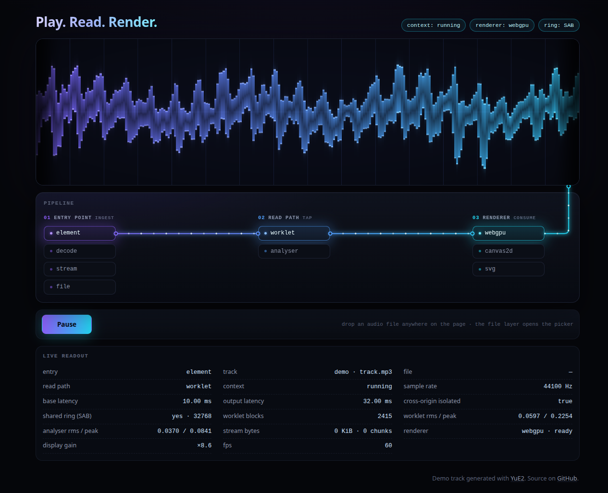

# wave-gpu

Play audio in the browser, read the same samples, and draw them with WebGPU.

Live demo: <https://wave.ltlian.com>



Four interchangeable ways of getting audio into the Web Audio graph — an `<audio>` element, a fully
decoded `AudioBuffer`, raw PCM over HTTP, and a dropped local file — feed the same tap, which drives
a WebGPU waveform. The demo track is a bundled MP3 (generated with YuE2, see
[CREDITS.md](CREDITS.md)); the raw-PCM entry plays a synthesized 12 s loop instead, because raw f32
of the full track would be ~80 MB.

## Features

- Four entry points, switchable while audio plays.
- Two read paths: an `AnalyserNode` and an `AudioWorklet` with a `SharedArrayBuffer` ring (falls
  back to `postMessage` without cross-origin isolation).
- One WebGPU consumer: 2048-sample frame → compute pass → WGSL waveform, with a Canvas2D fallback
  and a display-only auto-gain.
- Live readout of the context, both taps, the PCM stream and the GPU, plus a `window.__wave` probe.

## Requirements

- Node 24 or newer (CI uses 26).
- A WebGPU-capable browser (verified in Chrome); without WebGPU the visualization falls back to
  Canvas2D.
- Cross-origin isolation for the `SharedArrayBuffer` ring — the dev server and
  [public/_headers](public/_headers) set the COOP/COEP headers for you.

## Development

```bash
npm install
npm run dev        # http://127.0.0.1:5173
```

Press **Start**, then switch **entry point** and **read path** while it plays, or drop an audio file
on the page to use it as the source. One Vite process serves both the app and the audio endpoints
(`/api/meta`, `/stream/pcm`).

```bash
npm test           # node:test — synth, PCM chunking, display gain
npm run typecheck  # tsc, browser app and dev server
npm run build      # typecheck + production bundle + audio assets
npm run preview    # http://127.0.0.1:5174 — the built assets
```

## Deployment

The built site is static and deploys as a Cloudflare Worker with static assets only:

```bash
npm run deploy     # wrangler deploy, which builds first
```

Pushing to `main` deploys too, via
[.github/workflows/deploy.yml](.github/workflows/deploy.yml) and the `CLOUDFLARE_API_TOKEN` /
`CLOUDFLARE_ACCOUNT_ID` repository secrets. The domain is set in [wrangler.jsonc](wrangler.jsonc);
isolation headers come from [public/_headers](public/_headers).

## Project layout

```
src/audio/sources/      the four entry points
src/audio/taps/         the two read paths
src/gpu/                WebGPU consumer and Canvas2D fallback
server/                 dev-server audio endpoints (synth, PCM stream)
scripts/build-audio.ts  build-time audio assets for the deployed site
shared/audio.ts         constants shared by the browser app and the server
```

## Documentation

- [docs/architecture.md](docs/architecture.md) — layers, stream scheduling, the SAB ring, the
  AudioWorklet bundling trick, how to extend it.
- [docs/browser-audio.md](docs/browser-audio.md) — the browser API map: entry points, read paths,
  WebGPU feed options, streaming trade-offs and gotchas.

## License and credits

MIT — see [LICENSE](LICENSE).

- The demo track (`public/audio/track.mp3`) was generated with YuE2 and is excluded from the MIT
  licence; see [CREDITS.md](CREDITS.md).
- AI involvement is documented in [AI_DISCLOSURE.md](AI_DISCLOSURE.md).
