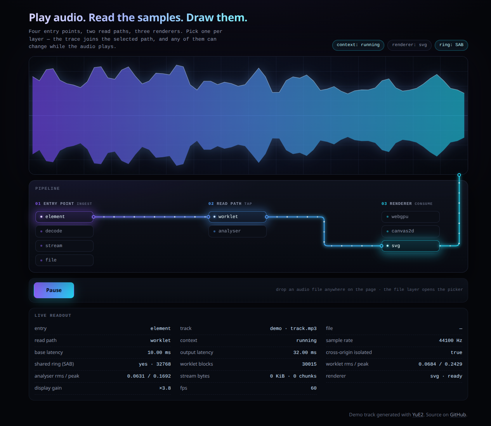

# wave-gpu

Play audio in the browser, read the same samples, and draw them three different ways.

Live demo: <https://wave.ltlian.com>


Four interchangeable ways of getting audio into the Web Audio graph — an `<audio>` element, a fully
decoded `AudioBuffer`, raw PCM over HTTP, and a dropped local file — feed the same tap, which drives
a three-column pipeline: entry point → read path → renderer. The selected route is traced between
the columns and up into the waveform frame, which can be drawn by WebGPU, Canvas2D or SVG. The demo track is a bundled MP3
(generated with YuE2, see [CREDITS.md](CREDITS.md)); the raw-PCM entry plays a synthesized 12 s loop
instead, because raw f32 of the full track would be ~80 MB.

The same frame, drawn by the SVG backend instead of WebGPU:



## Features

- Four entry points, switchable while audio plays.
- Two read paths: an `AnalyserNode` and an `AudioWorklet` with a `SharedArrayBuffer` ring (falls
  back to `postMessage` without cross-origin isolation).
- Three renderers for the same 2048-sample frame: WebGPU (compute pass → WGSL), Canvas2D (paths),
  and a retained-mode SVG/DOM layer — switchable while audio plays, with a display-only auto-gain.
- A pipeline panel: one column per layer, with the selected route traced between them and into the
  waveform frame.
- A mobile quality tier, selected automatically for coarse pointers / low core counts: 30 fps,
  1x backing store, fewer canvas/SVG columns and no blur. Force it on any device with
  `?quality=low` (or `?quality=high` to compare).
- Sound-reactive accents: the selected chips' LED dots, their glow and the trace follow the live
  output level (paint-only, one frame-loop write; static under `prefers-reduced-motion`).
- Live readout of the context, both taps, the PCM stream and the renderer, plus a `window.__wave` probe.

## Requirements

- Node 24 or newer (CI uses 26).
- A WebGPU-capable browser (verified in Chrome); without WebGPU the visualization falls back to
  Canvas2D, the renderer control disables WebGPU, and SVG stays selectable.
- Cross-origin isolation for the `SharedArrayBuffer` ring — the dev server and
  [public/_headers](public/_headers) set the COOP/COEP headers for you.

## Development

```bash
npm install
npm run dev        # http://127.0.0.1:5173
```

Press **Start**, then switch **entry point**, **read path** or **renderer** while it plays, or drop
an audio file on the page to use it as the source (the `file` layer opens the picker when nothing is
loaded). One Vite process serves both the app and the audio endpoints (`/api/meta`, `/stream/pcm`).

```bash
npm test           # node:test — synth, PCM chunking, display gain
npm run typecheck  # tsc, browser app and dev server
npm run build      # typecheck + production bundle + audio assets
npm run preview    # http://127.0.0.1:5174 — the built assets
```

## Deployment

The built site is static and deploys as a Cloudflare Worker with static assets only:

```bash
npm run deploy     # wrangler deploy, which builds first
```

Pushing to `main` deploys too, via
[.github/workflows/deploy.yml](.github/workflows/deploy.yml) and the `CLOUDFLARE_API_TOKEN` /
`CLOUDFLARE_ACCOUNT_ID` repository secrets. The domain is set in [wrangler.jsonc](wrangler.jsonc);
isolation headers come from [public/_headers](public/_headers).

## Project layout

```
src/audio/sources/      the four entry points
src/audio/taps/         the two read paths
src/gpu/                three renderers (WebGPU, Canvas2D, SVG) + cached stage backdrop
src/quality.ts          high/low performance tier selection
server/                 dev-server audio endpoints (synth, PCM stream)
scripts/build-audio.ts  build-time audio assets for the deployed site
shared/audio.ts         constants shared by the browser app and the server
```

## Documentation

- [docs/architecture.md](docs/architecture.md) — layers, stream scheduling, the SAB ring, the
  AudioWorklet bundling trick, how to extend it.
- [docs/browser-audio.md](docs/browser-audio.md) — the browser API map: entry points, read paths,
  WebGPU feed options, streaming trade-offs and gotchas.

## License and credits

MIT — see [LICENSE](LICENSE).

- The demo track (`public/audio/track.mp3`) was generated with YuE2 and is excluded from the MIT
  licence; see [CREDITS.md](CREDITS.md).
- AI involvement is documented in [AI_DISCLOSURE.md](AI_DISCLOSURE.md).
